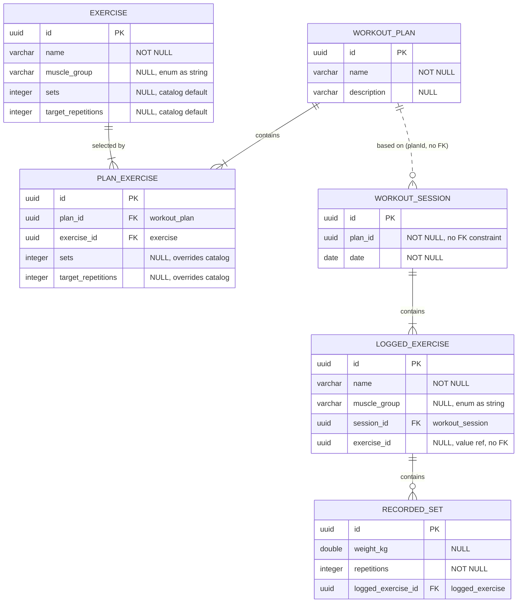

# Database Schema

Current model (Hibernate entities under `src/main/kotlin/persistence`). IDs are application-generated UUIDs; enum values (`muscle_group`) are stored as strings; UUID PKs/FKs resolve to `uuid` on PostgreSQL (H2 uses a compatible binary representation).

## Entity-Relationship Diagram

## Tables

### `exercise` (catalog)
Standalone, predefined exercises users select from. Seeded from `src/main/resources/seed/exercises.json` at startup when the table is empty.

| Column               | Type      | Constraints                                    |
| -------------------- | --------- | ---------------------------------------------- |
| `id`                 | `uuid`    | PK                                             |
| `name`               | `varchar` | `NOT NULL`                                     |
| `muscle_group`       | `varchar` | nullable, one of the `MuscleGroup` enum values |
| `sets`               | `integer` | nullable, suggested number of sets             |
| `target_repetitions` | `integer` | nullable, suggested repetitions per set        |

### `plan_exercise` (membership row)
A plan's selection of a catalog exercise. `NULL` sets/repetitions fall back to the catalog defaults.

| Column               | Type      | Constraints                           |
| -------------------- | --------- | ------------------------------------- |
| `id`                 | `uuid`    | PK                                    |
| `plan_id`            | `uuid`    | FK → `workout_plan.id`, `NOT NULL`   |
| `exercise_id`        | `uuid`    | FK → `exercise.id`, `NOT NULL`       |
| `sets`               | `integer` | nullable, overrides catalog default  |
| `target_repetitions` | `integer` | nullable, overrides catalog default  |

### `workout_plan`
A workout plan template (e.g. "Push Day A").

| Column        | Type      | Constraints |
| ------------- | --------- | ----------- |
| `id`          | `uuid`    | PK          |
| `name`        | `varchar` | `NOT NULL`  |
| `description` | `varchar` | nullable    |

### `workout_session`
A logged, completed workout.

| Column    | Type   | Constraints                                          |
| --------- | ------ | ---------------------------------------------------- |
| `id`      | `uuid` | PK                                                   |
| `plan_id` | `uuid` | `NOT NULL` — references the plan by value, **no FK** |
| `date`    | `date` | `NOT NULL`                                           |

### `logged_exercise`
An exercise actually performed during a session.

| Column         | Type      | Constraints                            |
| -------------- | --------- | -------------------------------------- |
| `id`           | `uuid`    | PK                                     |
| `name`         | `varchar` | `NOT NULL`                             |
| `muscle_group` | `varchar` | nullable, `MuscleGroup` enum as string |
| `session_id`   | `uuid`    | FK → `workout_session.id`, `NOT NULL` |
| `exercise_id`  | `uuid`    | nullable — references the catalog exercise by value, **no FK** |

### `recorded_set`
One performed set (reps + weight).

| Column               | Type      | Constraints                                 |
| -------------------- | --------- | ------------------------------------------- |
| `id`                 | `uuid`    | PK                                          |
| `weight_kg`          | `double`  | nullable (bodyweight exercises have no kg)  |
| `repetitions`        | `integer` | `NOT NULL`                                  |
| `logged_exercise_id` | `uuid`    | FK → `logged_exercise.id`, `NOT NULL`      |

## Relationships

| Relationship                        | Cardinality | Technique                                                                                 |
| ----------------------------------- | ----------- | ----------------------------------------------------------------------------------------- |
| `workout_plan` → `plan_exercise`    | 1 : n       | Unidirectional `@OneToMany`, shared join column, cascade ALL + orphanRemoval               |
| `exercise` → `plan_exercise`        | 1 : n       | `@ManyToOne` on the membership row (`exercise_id`)                                         |
| `workout_plan` ⇢ `workout_session`  | 1 : n       | Plain UUID reference (`plan_id`) — sessions survive plan template edits/deletes            |
| `workout_session` → `logged_exercise` | 1 : n     | Unidirectional `@OneToMany`, cascade ALL + orphanRemoval                                  |
| `exercise` ⇢ `logged_exercise`      | 1 : n       | Plain UUID reference (`exercise_id`) — logged exercises survive catalog edits/deletes      |
| `logged_exercise` → `recorded_set`  | 1 : n       | Same pattern                                                                              |

## Enum values (`muscle_group`)

Stored as strings (`@Enumerated(EnumType.STRING)`) — order-tolerant and stable on PostgreSQL.

`CHEST` · `BACK` · `SHOULDERS` · `BICEPS` · `TRICEPS` · `LEGS` · `CORE` · `FULL_BODY`

## Notes

- Schema is currently created/updated by Hibernate (`ddl-auto=update`).
- For PostgreSQL later, switch to `ddl-auto=validate` + a migration tool like Flyway/Liquibase; `uuid` types and the shared join columns are PostgreSQL-ready.
- Deleting a plan deletes its `plan_exercise` membership rows (orphan removal), but **never touches the catalog itself** (`exercise` rows are shared).
- Child rows of sessions are deleted with their parent (orphan removal). A logged exercise's `exercise_id` is a soft reference: it points back to the catalog exercise it was picked from, but becomes stale (not deleted) when that catalog exercise is removed.
