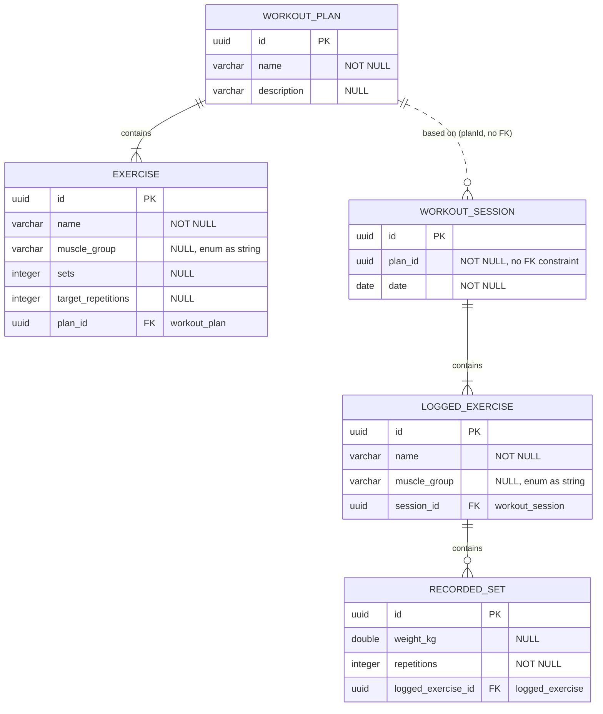

# Database Schema

Current model (Hibernate entities under `src/main/kotlin/persistence`). IDs are application-generated UUIDs; enum values (`muscle_group`) are stored as strings; UUID PKs/FKs resolve to `uuid` on PostgreSQL (H2 uses a compatible binary representation).

## Entity-Relationship Diagram

## Tables

### `workout_plan`
A workout plan template (e.g. "Push Day A").

| Column        | Type         | Constraints           |
| ------------- | ------------ | --------------------- |
| `id`          | `uuid`       | PK                    |
| `name`        | `varchar`    | `NOT NULL`            |
| `description` | `varchar`    | nullable              |

### `exercise`
An exercise slot inside a plan template.

| Column               | Type      | Constraints                                          |
| -------------------- | --------- | ---------------------------------------------------- |
| `id`                 | `uuid`    | PK                                                   |
| `name`               | `varchar` | `NOT NULL`                                           |
| `muscle_group`       | `varchar` | nullable, one of the `MuscleGroup` enum values       |
| `sets`               | `integer` | nullable                                             |
| `target_repetitions` | `integer` | nullable                                             |
| `plan_id`            | `uuid`    | FK → `workout_plan.id`, `NOT NULL` (shared join col) |

### `workout_session`
A logged, completed workout.

| Column    | Type    | Constraints                                          |
| --------- | ------- | ---------------------------------------------------- |
| `id`      | `uuid`  | PK                                                   |
| `plan_id` | `uuid`  | `NOT NULL` — references the plan by value, **no FK** |
| `date`    | `date`  | `NOT NULL`                                           |

### `logged_exercise`
An exercise actually performed during a session.

| Column        | Type      | Constraints                            |
| ------------- | --------- | -------------------------------------- |
| `id`          | `uuid`    | PK                                     |
| `name`        | `varchar` | `NOT NULL`                             |
| `muscle_group`| `varchar` | nullable, `MuscleGroup` enum as string |
| `session_id`  | `uuid`    | FK → `workout_session.id`, `NOT NULL` |

### `recorded_set`
One performed set (reps + weight).

| Column              | Type      | Constraints                                 |
| ------------------- | --------- | ------------------------------------------- |
| `id`                | `uuid`    | PK                                          |
| `weight_kg`         | `double`  | nullable (bodyweight exercises have no kg)  |
| `repetitions`       | `integer` | `NOT NULL`                                  |
| `logged_exercise_id`| `uuid`    | FK → `logged_exercise.id`, `NOT NULL`      |

## Relationships

| Relationship                              | Cardinality | Technique                                                                 |
| ----------------------------------------- | ----------- | ------------------------------------------------------------------------- |
| `workout_plan` → `exercise`               | 1 : n       | Unidirectional `@OneToMany` with shared join column, cascade ALL + orphanRemoval |
| `workout_session` → `logged_exercise`     | 1 : n       | Same pattern                                                              |
| `logged_exercise` → `recorded_set`        | 1 : n       | Same pattern                                                              |
| `workout_plan` ⇢ `workout_session`        | 1 : n       | Plain UUID reference (`plan_id`) — sessions survive plan template edits/deletes |

## Enum values (`muscle_group`)

Stored as strings (`@Enumerated(EnumType.STRING)`) — order-tolerant and stable on PostgreSQL.

`CHEST` · `BACK` · `SHOULDERS` · `BICEPS` · `TRICEPS` · `LEGS` · `CORE` · `FULL_BODY`

## Notes

- Schema is currently created/updated by Hibernate (`ddl-auto=update`).
- For PostgreSQL later, switch to `ddl-auto=validate` + Flyway/Liquibase migrations; the shared join columns and `uuid` types are PostgreSQL-ready.
- Child rows are deleted with their parent (orphan removal), so deleting a plan/session cleans up its exercises and sets.
